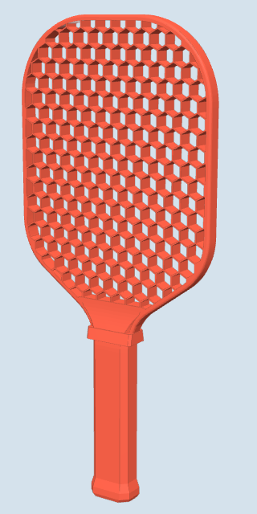

# Honeycomb Pickleball Paddle

ไม้พิกเกิลบอลแบบชิ้นเดียว ไม่มีแผ่นผิวหน้า หน้าไม้เป็นรังผึ้งหกเหลี่ยมที่ทะลุตลอดความหนา
ยึดด้วยขอบตันรอบหน้าไม้ และต่อเป็นชิ้นเดียวกับด้ามจับทรงแปดเหลี่ยมยาว 6 นิ้ว
โดยหน้าไม้อยู่กึ่งกลางความหนาของด้าม มีสามทรง คือมาตรฐาน, hybrid และ elongated
โดยอิงขนาดจากไม้รุ่นปัจจุบันของ Selkirk, JOOLA และ RPM



## ไฟล์

| ไฟล์ | รายละเอียด |
| --- | --- |
| `stl/pickleball_paddle_standard.stl` | ทรงมาตรฐาน |
| `stl/pickleball_paddle_hybrid.stl` | ทรง hybrid |
| `stl/pickleball_paddle_elongated.stl` | ทรง elongated |
| `generate_paddle.py` | สคริปต์สร้างโมเดล ปรับค่าได้จาก `HANDLE_LENGTH`, `SHAPES` และค่าคงที่ที่ส่วนบนของไฟล์ |

## ทรง

ทุกทรงมีมุมบนมนรัศมีใหญ่ ด้านข้างตรง และส่วนล่างเรียวเป็นรูปตัว V ลงไปหาคอไม้
แล้วโค้งเว้าเข้าด้าม มีปลอกคอหุ้มรอยต่อระหว่างด้ามกับหน้าไม้ เหมือนไม้รุ่นปัจจุบัน
มุมบนและส่วนเรียวของทรง elongated ฟิตจากภาพ JOOLA Perseus (คลาดเคลื่อน RMS 0.9 mm)
แต่ด้านข้างตรงสั้นกว่า 15 mm เพราะด้ามยาวกว่า

| | มาตรฐาน | Hybrid | Elongated |
| --- | --- | --- | --- |
| ยาว × กว้าง | 400 × 197 mm (15.75 × 7.76 in) | 412.5 × 195.5 mm (16.24 × 7.70 in) | 419 × 190 mm (16.50 × 7.48 in) |
| ยาว + กว้าง (กติกาไม่เกิน 24 in) | 23.50 in | 23.94 in | 23.98 in |
| ความยาวด้าม (ถึงคอไม้) | 152.4 mm (6.00 in) | 152.4 mm (6.00 in) | 152.4 mm (6.00 in) |
| รัศมีมุมบน | 52 mm | 62 mm | 70 mm |
| ช่องรังผึ้ง | 227 | 231 | 215 |
| น้ำหนักโดยประมาณ | 218 g (7.7 oz) | 218 g (7.7 oz) | 213 g (7.5 oz) |
| จุดสมดุลจากปลายด้าม | 217 mm | 222 mm | 224 mm |
| ฐานพิมพ์จัตุรัสขั้นต่ำ (ตั้งสันข้าง วางทแยง) | 296 mm | 305 mm | 309 mm |
| ความสูงตอนพิมพ์ | 197 mm | 196 mm | 190 mm |

ทุกทรงใช้ค่าเดียวกันดังนี้: หน้าไม้หนา 13 mm, ขอบตัน 4.5 mm, ช่องรังผึ้งกว้าง 14 mm ผนัง 1.0 mm,
ด้ามแปดเหลี่ยม 36 × 24 mm (เส้นรอบวง 108 mm หรือ 4.25 in) หน้าไม้อยู่กึ่งกลางด้าม
ด้ามจึงนูนออกจากหน้าไม้ด้านละ 5.5 mm

ความยาวรวมคงไว้ให้อยู่ในกติกา ด้ามที่ยาวขึ้นจึงทำให้หน้าไม้สั้นลง 15–19 mm

น้ำหนักและจุดสมดุลคำนวณจากปริมาตร โดยใช้ความหนาแน่น 1.25 g/cm³ (PETG/PLA)
ถือว่าหน้าไม้ตัน 100% และด้ามเติมเนื้อ 35%

## ไม้รุ่นจริงที่ใช้อ้างอิง

| รุ่น | ทรง | ยาว (in) | กว้าง (in) | ด้าม (in) |
| --- | --- | --- | --- | --- |
| JOOLA Perseus | Elongated, หัวเหลี่ยม | 16.5 | 7.5 | 5.5 |
| JOOLA Hyperion | Elongated, หัวมน | 16.5 | 7.5 | 5.5 |
| RPM Friction Pro Elongated | Elongated | 16.5 | 7.5 | 5.5 |
| Selkirk Elongated | Elongated | 16.5 | 7.45 | 5.8 |
| Selkirk Invikta | Elongated | 16.5 | 7.375 | 5.25 |
| RPM Q2 Hybrid Flat Top | Hybrid | 16.25 | 7.7 | 5.5 |
| Selkirk Epic | มาตรฐาน | 15.75 | 8 | 5.25 |

ที่มา: [Selkirk shapes](https://www.selkirk.com/pages/shapes),
[Pickleheads: Perseus vs Hyperion](https://www.pickleheads.com/pickleball-gear/joola-perseus-vs-hyperion),
[Pickleball Central: RPM Friction Pro Elongated](https://pickleballcentral.com/rpm-friction-pro-14mm-elongated-v2-pickleball-paddle/),
[Matt's Pickleball: RPM Q2 Hybrid Flat Top](https://www.mattspickleball.com/paddle/q2-hybrid-flat-top-16mm)

## การพิมพ์

ด้ามนูนออกจากหน้าไม้ทั้งสองด้าน ถ้าวางนอน หน้าไม้จะลอยจากฐาน 5.5 mm ทั้งแผ่น จึงควรพิมพ์แบบตั้งสันข้าง

- ตั้งไม้บนสันข้างยาว ให้หน้าไม้ตั้งฉากกับฐาน (ในสไลเซอร์ หมุน 90° รอบแกนความยาวของไม้)
- ช่องรังผึ้งจะกลายเป็นอุโมงค์แนวนอน เพดานแต่ละช่องเป็นสะพานยาว 8 mm พิมพ์ได้โดยไม่ต้องมีซัพพอร์ตข้างใน
- ใช้ซัพพอร์ตแบบ tree ตั้งค่าให้แตะฐานเท่านั้น จะเกิดซัพพอร์ตใต้ด้ามและปลอกคอ (สูงจากฐาน 6–8 cm) และใต้โค้งปลายสองข้างของขอบล่าง (สูงไม่เกิน 2 cm)
- สันที่แตะฐานกว้างประมาณ 9 mm ควรใส่ brim 5–8 mm กันล้ม
- ฐานจัตุรัสตั้งแต่ 310 mm ขึ้นไปพอเมื่อวางทแยง และต้องพิมพ์ได้สูงประมาณ 200 mm ฐาน 350×350 ใส่ได้ทุกทรงพร้อม brim
- แนะนำ PETG เพราะทนแรงกระแทกดีกว่า PLA ตั้งเส้นผนัง 2 เส้น กว้างประมาณ 0.5 mm, เลเยอร์ 0.2 mm, ด้ามใช้ infill แบบ gyroid ประมาณ 15–20%

ถ้าอยากวางนอนพิมพ์โดยไม่ใช้ซัพพอร์ต ใช้ `--grip flat` ได้ ด้ามจะเรียบเสมอกับด้านล่างของหน้าไม้
แต่หน้าไม้จะเยื้องจากแกนด้าม 5.5 mm

## สร้างใหม่

```sh
pip install manifold3d numpy
python3 generate_paddle.py --all                      # ทุกทรง
python3 generate_paddle.py --shape hybrid             # stl/pickleball_paddle_hybrid.stl
python3 generate_paddle.py --shape elongated --grip flat
```

## ข้อควรรู้

- กติกา USA Pickleball ไม่อนุญาตให้หน้าไม้มีรู ไม้นี้จึงใช้แข่งในรายการที่รับรองไม่ได้ เหมาะกับการเล่นสนุกหรือซ้อม
- ทรง hybrid และ elongated ยาวรวมกว้างเกือบชนเพดาน 24 in เหมือนไม้จริง ถ้าพิมพ์แล้วชิ้นงานขยายตัวอาจเกินเล็กน้อย
