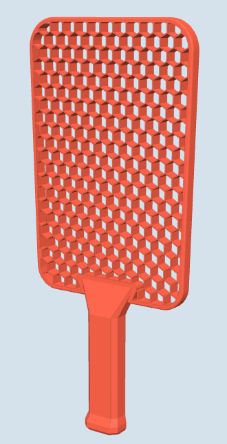

# Honeycomb Pickleball Paddle

ไม้พิกเกิลบอลแบบชิ้นเดียว ไม่มีแผ่นผิวหน้า หน้าไม้เป็นรังผึ้งหกเหลี่ยมที่ทะลุตลอดความหนา
ยึดด้วยขอบตันรอบหน้าไม้ และต่อเป็นชิ้นเดียวกับด้ามจับทรงแปดเหลี่ยม มีสามทรง
คือมาตรฐาน, hybrid และ elongated โดยอิงขนาดจากไม้รุ่นปัจจุบันของ Selkirk, JOOLA และ RPM



## ไฟล์

ไฟล์ STL อยู่ในโฟลเดอร์ `stl/` ทรงละ 2 ไฟล์

| ไฟล์ | รายละเอียด |
| --- | --- |
| `pickleball_paddle_<ทรง>.stl` | ด้านล่างด้ามเรียบเสมอกับหน้าไม้ วางนอนพิมพ์ได้โดยไม่ต้องใช้ซัพพอร์ต |
| `pickleball_paddle_<ทรง>_symmetric.stl` | ด้ามอยู่กึ่งกลางความหนาของหน้าไม้ จับได้สมดุลกว่า แต่ต้องใช้ซัพพอร์ตตอนพิมพ์ |
| `generate_paddle.py` | สคริปต์สร้างโมเดล ปรับค่าได้จาก `SHAPES` และค่าคงที่ที่ส่วนบนของไฟล์ |

`<ทรง>` คือ `standard`, `hybrid` หรือ `elongated`

## ทรง

| | มาตรฐาน | Hybrid | Elongated |
| --- | --- | --- | --- |
| ยาว × กว้าง | 400 × 197 mm (15.75 × 7.76 in) | 412.5 × 195.5 mm (16.24 × 7.70 in) | 419 × 190 mm (16.50 × 7.48 in) |
| ยาว + กว้าง (กติกาไม่เกิน 24 in) | 23.50 in | 23.94 in | 23.98 in |
| ความยาวด้าม | 133 mm (5.24 in) | 140 mm (5.51 in) | 140 mm (5.51 in) |
| มุมบน | มน R38 | มน R42 | ค่อนข้างเหลี่ยม R30 |
| ช่องรังผึ้ง | 272 | 258 | 254 |
| น้ำหนักโดยประมาณ | 230 g (8.1 oz) | 231 g (8.1 oz) | 230 g (8.1 oz) |
| จุดสมดุลจากปลายด้าม | 212 mm | 220 mm | 222 mm |
| ฐานพิมพ์จัตุรัสขั้นต่ำ (วางทแยง) | 351 mm | 357 mm | 365 mm |

ทุกทรงใช้ค่าเดียวกันดังนี้: หน้าไม้หนา 13 mm, ขอบตัน 4.5 mm, ช่องรังผึ้งกว้าง 14 mm ผนัง 1.0 mm,
ด้ามแปดเหลี่ยม 36 × 24 mm (เส้นรอบวง 108 mm หรือ 4.25 in) ทรง hybrid และ elongated
เรียวแคบลงเล็กน้อยไปทางคอไม้

น้ำหนักและจุดสมดุลคำนวณจากปริมาตร โดยใช้ความหนาแน่น 1.25 g/cm³ (PETG/PLA)
ถือว่าหน้าไม้ตัน 100% และด้ามเติมเนื้อ 35%

## ไม้รุ่นจริงที่ใช้อ้างอิง

| รุ่น | ทรง | ยาว (in) | กว้าง (in) | ด้าม (in) |
| --- | --- | --- | --- | --- |
| JOOLA Perseus | Elongated, หัวเหลี่ยม | 16.5 | 7.5 | 5.5 |
| JOOLA Hyperion | Elongated, หัวมน | 16.5 | 7.5 | 5.5 |
| RPM Friction Pro Elongated | Elongated | 16.5 | 7.5 | 5.5 |
| Selkirk Elongated | Elongated | 16.5 | 7.45 | 5.8 |
| Selkirk Invikta | Elongated | 16.5 | 7.375 | 5.25 |
| RPM Q2 Hybrid Flat Top | Hybrid | 16.25 | 7.7 | 5.5 |
| Selkirk Epic | มาตรฐาน | 15.75 | 8 | 5.25 |

ที่มา: [Selkirk shapes](https://www.selkirk.com/pages/shapes),
[Pickleheads: Perseus vs Hyperion](https://www.pickleheads.com/pickleball-gear/joola-perseus-vs-hyperion),
[Pickleball Central: RPM Friction Pro Elongated](https://pickleballcentral.com/rpm-friction-pro-14mm-elongated-v2-pickleball-paddle/),
[Matt's Pickleball: RPM Q2 Hybrid Flat Top](https://www.mattspickleball.com/paddle/q2-hybrid-flat-top-16mm)

## การพิมพ์

- ฐานพิมพ์ 400×400 mm ใส่ได้ทั้งสามทรง (ทรง hybrid และ elongated ต้องวางทแยง) ส่วนฐาน 350×350 ใส่ไม่ได้สักทรง
- วางนอนให้หน้าไม้แนบฐาน
- แนะนำ PETG เพราะทนแรงกระแทกดีกว่า PLA
- ตั้งเส้นผนัง 2 เส้น กว้างประมาณ 0.5 mm, เลเยอร์ 0.2 mm, ด้ามใช้ infill แบบ gyroid ประมาณ 15–20%

## สร้างใหม่

```sh
pip install manifold3d numpy
python3 generate_paddle.py --all                               # ทุกทรง ทั้งสองแบบด้าม
python3 generate_paddle.py --shape hybrid                      # stl/pickleball_paddle_hybrid.stl
python3 generate_paddle.py --shape elongated --grip symmetric
```

## ข้อควรรู้

- กติกา USA Pickleball ไม่อนุญาตให้หน้าไม้มีรู ไม้นี้จึงใช้แข่งในรายการที่รับรองไม่ได้ เหมาะกับการเล่นสนุกหรือซ้อม
- ทรง hybrid และ elongated ยาวรวมกว้างเกือบชนเพดาน 24 in เหมือนไม้จริง ถ้าพิมพ์แล้วชิ้นงานขยายตัวอาจเกินเล็กน้อย
