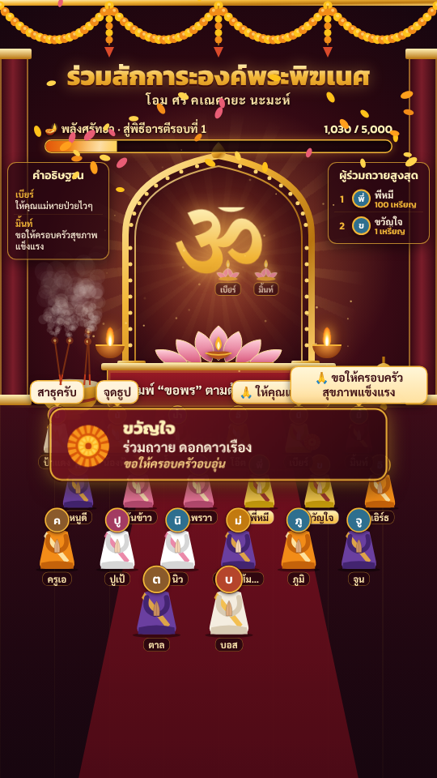

# ฉากไลฟ์ TikTok: ร่วมสักการะพระพิฆเนศ

ฉากไลฟ์ที่คนดูเข้ามาเป็นผู้ร่วมสักการะ แต่ละคนนั่งพนมมือหน้าแท่นบูชาพร้อมชื่อและรูปโปรไฟล์ของตัวเอง
คอมเมนต์ขึ้นเป็นกรอบคำพูด และของขวัญทุกชิ้นจะกลายเป็นของถวายบนแท่นบูชา



## ต้องมีอะไรบ้าง

- คอมพิวเตอร์ Windows หรือ Mac ที่ใช้ไลฟ์
- [Node.js](https://nodejs.org) รุ่น LTS (ติดตั้งครั้งเดียว)
- TikTok LIVE Studio ที่ล็อกอินบัญชีที่เปิดไลฟ์ได้
- **ไม่ต้อง**สมัคร TikTok Developer และ**ไม่ต้อง**ใส่รหัสผ่าน TikTok ใช้แค่ชื่อช่อง

## เปิดโปรแกรม

1. ดาวน์โหลดโปรเจกต์นี้ (ปุ่ม Code → Download ZIP) แล้วแตกไฟล์ เปิดโฟลเดอร์ `ganesha-live`
2. เปิดโปรแกรม
   - **Windows:** ดับเบิลคลิก `start-windows.bat`
   - **Mac:** คลิกขวาที่ `start-mac.command` → Open (ครั้งแรก Mac จะถามยืนยัน)
3. ครั้งแรกจะติดตั้งส่วนประกอบสักครู่ จากนั้นเบราว์เซอร์จะเปิด **หน้าควบคุม** ให้เอง (`http://localhost:3939`)
4. **เปิดหน้าต่างโปรแกรมทิ้งไว้ตลอดการไลฟ์** ปิดหน้าต่าง = ปิดโปรแกรม

ถ้าดับเบิลคลิกไม่ได้ ให้เปิด Terminal (Mac) หรือ Command Prompt (Windows) ในโฟลเดอร์นี้ แล้วพิมพ์

```
npm install
npm start
```

## เริ่มไลฟ์

1. ในหน้าควบคุม ใส่ชื่อช่อง TikTok แล้วกด **เชื่อมต่อ** (กดก่อนเริ่มไลฟ์ได้เลย โปรแกรมจะรอและเชื่อมต่อให้เองเมื่อไลฟ์เริ่ม)
2. ใน TikTok LIVE Studio กด **เพิ่มแหล่งที่มา → ลิงก์** แล้ววาง `http://localhost:3939/scene.html`
   ตั้งขนาด **กว้าง 1080 สูง 1920** และลากให้เต็มจอแนวตั้ง
3. ทดสอบด้วยปุ่มในหัวข้อ **ทดสอบฉาก** ก่อนได้ ไม่ต้องไลฟ์จริง
4. เริ่มไลฟ์

อยากให้เห็นกล้องอยู่ด้านหลัง ใช้ลิงก์ `http://localhost:3939/scene.html?bg=0` (พื้นหลังโปร่งใส) แล้ววางไว้เหนือกล้อง

## คนดูทำอะไรได้บ้าง

| คนดูทำ | ในฉาก |
|---|---|
| เข้ามาในไลฟ์ | เดินเข้าฉาก นั่งพนมมือพร้อมชื่อและรูปโปรไฟล์ คนมาก่อนได้นั่งแถวหน้า |
| พิมพ์ **สาธุ** หรือ 🙏 | ก้มกราบ มีแสงทองและคำว่า "สาธุ" ลอยขึ้น |
| พิมพ์ **ขอพร** / **อธิษฐาน** / **ขอให้…** ตามด้วยคำอธิษฐาน | ดวงประทีปดอกบัวลอยขึ้นไปหาองค์พระ คำอธิษฐานขึ้นในกรอบ "คำอธิษฐาน" |
| พิมพ์ **จุดธูป** | ธูปดอกใหม่ปักลงกระถาง มีควันลอย |
| พิมพ์ **โอม** | สัญลักษณ์ ॐ เปล่งแสง |
| คอมเมนต์อื่น ๆ | ขึ้นเป็นกรอบคำพูดเหนือตัวละคร |
| กดใจ | กลีบดาวเรืองโปรยลงมา |
| กดติดตาม | ได้พวงมาลัยคล้องคอ และขึ้นข้อความขอบคุณ |
| แชร์ไลฟ์ | ขึ้นข้อความขอบคุณ |

### ของขวัญ → ของถวาย

| ราคาของขวัญ (เหรียญต่อชิ้น) | กลายเป็น |
|---|---|
| 1–4 | ดอกดาวเรือง |
| 5–19 | พวงมาลัยดาวเรือง |
| 20–99 | ขนมลาดู |
| 100–299 | ประทีปบูชา |
| 300–999 | ถาดผลไม้มงคล |
| 1,000 ขึ้นไป | พานบูชาทองคำ |

- ของถวายบินจากตัวละครไปวางบนแท่นบูชา มีป้ายขึ้นชื่อผู้ถวายพร้อมคำอวยพร และเสียงระฆัง
- ของขวัญรวม 500 เหรียญขึ้นไป **หนูมุสิกะ** (พาหนะของพระพิฆเนศ) จะวิ่งผ่านแท่นบูชาพร้อมฝนทอง
- ทุกการมีส่วนร่วมเพิ่ม **พลังศรัทธา** พอครบเป้าจะเริ่ม **พิธีอารตี** มีประทีปหมุนรอบองค์พระ ฝนทอง และทุกคนในฉากก้มกราบพร้อมกัน
- กรอบ **ผู้ร่วมถวายสูงสุด** แสดง 5 อันดับแรก และจำไว้แม้ปิดเปิดโปรแกรมใหม่ (กดรีเซ็ตได้ในหน้าควบคุม)

## ตั้งค่า

ในหน้าควบคุม หัวข้อ **ตั้งค่าฉาก**

- ชื่อฉาก และบทสวดที่แสดงด้านบน
- เป้าพลังศรัทธาสำหรับเริ่มพิธีอารตี (ค่าเริ่มต้น 3,000) และการคิดแต้มของแต่ละอย่าง
- เปิด/ปิดเสียงระฆัง
- คำต้องห้าม: คำที่ไม่อยากให้ขึ้นจอ จะถูกแทนด้วย `***`
- **รูปองค์พระพิฆเนศ**: ใช้รูปที่คุณถ่ายเองหรือมีสิทธิ์ใช้ ไฟล์ PNG พื้นหลังโปร่งใสจะสวยที่สุด ถ้าไม่ใส่ จะแสดงสัญลักษณ์ ॐ

## ปัญหาที่พบบ่อย

- **ขึ้นว่า "ยังไม่ได้เริ่มไลฟ์"**: ปกติ โปรแกรมจะลองใหม่ทุก 30 วินาที และเชื่อมต่อเองเมื่อไลฟ์เริ่ม
- **ฉากใน LIVE Studio ไม่ขยับ หรือขึ้นว่า "ยังเชื่อมต่อโปรแกรมไม่ได้"**: ตรวจว่าหน้าต่างโปรแกรมยังเปิดอยู่
- **ไม่มีเสียงระฆังในไลฟ์**: ตรวจการตั้งค่าเสียงของแหล่งที่มาแบบลิงก์ใน LIVE Studio และการตั้งค่า "เสียงระฆัง" ในหน้าควบคุม
- **ขึ้นว่าพอร์ต 3939 ถูกใช้อยู่**: โปรแกรมเปิดอยู่แล้ว ให้เข้า `http://localhost:3939` ได้เลย
- **ปิดการจำลองอัตโนมัติ** ทุกครั้งก่อนไลฟ์จริง ไม่อย่างนั้นคนดูจะเห็นชื่อสมมติ

## ข้อควรรู้

- โปรแกรมอ่านข้อมูลไลฟ์ผ่านไลบรารี [tiktok-live-connector](https://github.com/zerodytrash/TikTok-Live-Connector) ซึ่งไม่ใช่ของ TikTok อย่างเป็นทางการ ถ้า TikTok เปลี่ยนระบบ อาจใช้ไม่ได้ชั่วคราวจนกว่าไลบรารีจะอัปเดต
- ระวังกติกาของ TikTok: ไม่ควรสัญญาว่าส่งของขวัญแล้วจะโชคดีหรือร่ำรวย ไม่ทำเกมแนวเสี่ยงโชค และไม่ควรเปิดฉากทิ้งไว้นาน ๆ โดยไม่มีคนดูแล เพราะอาจถูกจำกัดการมองเห็น
- ฉากเป็นการแสดงความเคารพ ตัวละครทุกตัวพนมมือและกราบไหว้ ไม่มีกิจกรรมที่ล้อเลียนองค์พระ

## สำหรับนักพัฒนา

```
ganesha-live/
├── server.js            โปรแกรมหลัก: ต่อ TikTok, ส่งเหตุการณ์ให้หน้าฉากผ่าน WebSocket, เก็บค่าใน data/
├── public/
│   ├── scene.html       หน้าฉาก (ใส่ใน LIVE Studio) · ?demo = จำลองเอง ไม่ต้องมี server
│   ├── control.html     หน้าควบคุม
│   ├── js/game.js       กติกา: แยกประเภทคอมเมนต์ ของถวาย แต้ม อันดับ (ใช้ร่วมกันทั้ง server และหน้าฉาก)
│   ├── js/sim.js        ตัวจำลองเหตุการณ์ไลฟ์
│   ├── js/scene.js      วาดตัวละคร ของถวาย เอฟเฟกต์ เสียง
│   └── js/control.js
└── data/                ค่าที่บันทึกไว้ (สร้างเอง ไม่อยู่ใน git)
```

- โปรแกรมเปิดให้ใช้เฉพาะในเครื่องตัวเอง (`127.0.0.1`) และไม่รับคำสั่งจากเว็บไซต์อื่น
- ดูฉากแบบจำลองโดยไม่ต้องรันโปรแกรม: เปิด `public/scene.html?demo` ผ่านเว็บเซิร์ฟเวอร์ใดก็ได้

## แผนต่อไป

- **เฟส 2:** ย้ายหน้าฉากขึ้น Vercel/Netlify และใช้ Supabase ส่งเหตุการณ์และเก็บอันดับ เปิดหน้าควบคุมจากมือถือได้
- **เฟส 3:** เสียง AI ภาษาไทยขอบคุณผู้ถวาย มินิเกมเพิ่มเติม และห่อเป็นโปรแกรม .exe / .app ที่ดับเบิลคลิกเปิดได้เลยโดยไม่ต้องลง Node.js
